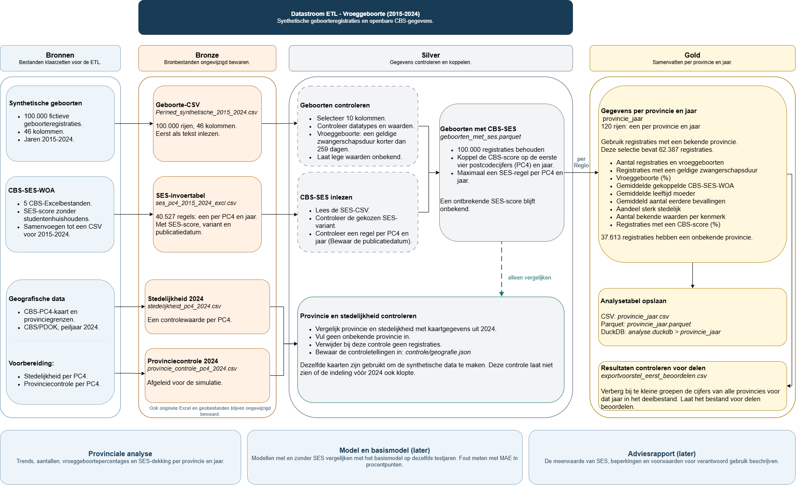

# Vroeggeboorteonderzoek - ETL en EDA

Dit onderwijsproject hoort bij mijn opleiding Applied Data Science & AI aan Hogeschool Rotterdam. Samen met mijn team onderzoek ik hoe vroeggeboortepercentages per Nederlandse provincie kunnen worden voorspeld met sociaaleconomische, demografische en omgevingskenmerken.

Mijn deelvraag gaat over de aanvullende voorspellende waarde van de CBS-SES-WOA-score. Deze repository laat mijn individuele EDA, ETL-ontwerp en planning zien.

**Status:** de EDA, synthetische geboortedata en diagrammen zijn beschikbaar. De ETL-code, CBS-invoertabellen en automatische tests worden nog aan deze repository toegevoegd. Het trainen en vergelijken van modellen volgt later.

## Doel en mijn bijdrage

Voor het onderzoek is een bruikbare dataset per provincie en jaar nodig. Mijn onderdeel richt zich op het onderzoeken van de datakwaliteit en het uitwerken van een ETL-pijplijn die geboortegegevens aan openbare CBS-gegevens koppelt.

De EDA onderzoekt ontbrekende en onbekende waarden, verdelingen, uitschieters en logische combinaties. De bevindingen worden vertaald naar controles en keuzes voor de ETL. Zo blijven registraties met een onbekende provincie apart verantwoord en worden vroeggeboorten niet automatisch als uitschieter verwijderd.

## Inhoud

| Onderdeel | Bestand of map |
| --- | --- |
| EDA met code, grafieken en toelichting | [notebooks/EDA.ipynb](notebooks/EDA.ipynb) |
| Synthetische geboortegegevens | `datasets/Perined_synthetische_2015_2024.csv` |
| Architectuur, activitydiagram en datastroom | [diagrammen/](diagrammen/) |
| Screenshots van mijn GitLab-taken | [voortgang/](voortgang/) |

De taakscreenshots laten de planning zien. De status van de bestanden in deze repository staat bovenaan deze README.

## ETL-ontwerp

De pijplijn wordt uitgewerkt met Python en Prefect en bestaat uit drie lagen:

| Laag | Verwerking |
| --- | --- |
| **Bronze** | Bronbestanden ongewijzigd bewaren en controleren op structuur en omvang. |
| **Silver** | Datatypes en waarden controleren, vroeggeboorte afleiden en CBS-SES-WOA koppelen op PC4 en jaar. |
| **Gold** | Samenvatten per provincie en jaar, met aantallen, vroeggeboortepercentages, gemiddelde kenmerken en dekking. |

PC4 zijn de eerste vier cijfers van een postcode. Bij de SES-koppeling blijven alle geboorteregistraties behouden. Ontbrekende scores blijven onbekend. Het ontwerp voorziet in uitvoer als CSV, Parquet en DuckDB.



Bekijk ook het [activitydiagram](diagrammen/Activity_diagram_ETL.png) en het [architectuurdiagram](diagrammen/Architectuur_ETL.png). De bewerkbare `.drawio`-bestanden staan in dezelfde map.

## Data en beperkingen

De geboortedataset bevat **100.000 fictieve registraties en 46 kolommen** voor 2015 tot en met 2024. De structuur en referentiecijfers zijn gebaseerd op de aangeleverde Perined-metadata.

De kolom `ses_percentiel` is gesimuleerd en heeft een andere schaal en betekenis dan CBS-SES-WOA. De openbare CBS-score wordt in de ETL apart gekoppeld. Een gebiedsscore beschrijft bovendien geen individuele zwangere.

De EDA-resultaten beschrijven de simulatie en zijn geen gemeten Nederlandse zorgcijfers. Ze worden gebruikt om de verwerking te ontwikkelen. Verbanden in deze data bewijzen geen oorzaak of voorspellende meerwaarde. De provinciale analysetabel bevat maximaal 120 combinaties van provincie en jaar.

## EDA lokaal uitvoeren

Download de repository of clone deze:

```bash
git clone https://github.com/younes-et-talby/preterm-birth-etl.git
cd preterm-birth-etl
```

Gebruik een aparte Python-omgeving en installeer de pakketten voor de EDA:

```bash
python -m pip install pandas matplotlib seaborn jupyterlab
python -m jupyterlab
```

Open `notebooks/EDA.ipynb`. In de huidige versie zoekt het notebook de CSV nog in dezelfde map. Wanneer de notebookkernel vanuit `notebooks/` draait, vervang je de inleesregel in de eerste codecel door:

```python
raw = pd.read_csv(
    "../datasets/Perined_synthetische_2015_2024.csv",
    dtype="string",
    keep_default_na=False,
    na_values=[""]
)
```

Voer daarna de cellen van boven naar beneden uit. De bestaande uitvoer en toelichting zijn ook direct op GitHub te bekijken.

## Vervolg

- De ETL-code, instellingen en benodigde openbare invoertabellen toevoegen.
- Automatische tests en volledige uitvoerinstructies opnemen.
- Later modellen met en zonder SES vergelijken met een basismodel, op dezelfde testjaren.
- De resultaten en beperkingen verwerken in het gezamenlijke adviesrapport.
